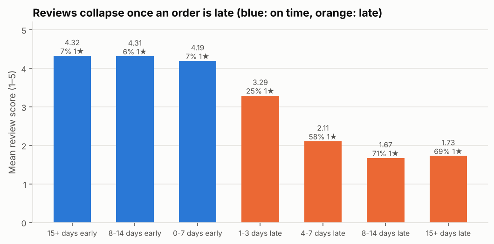
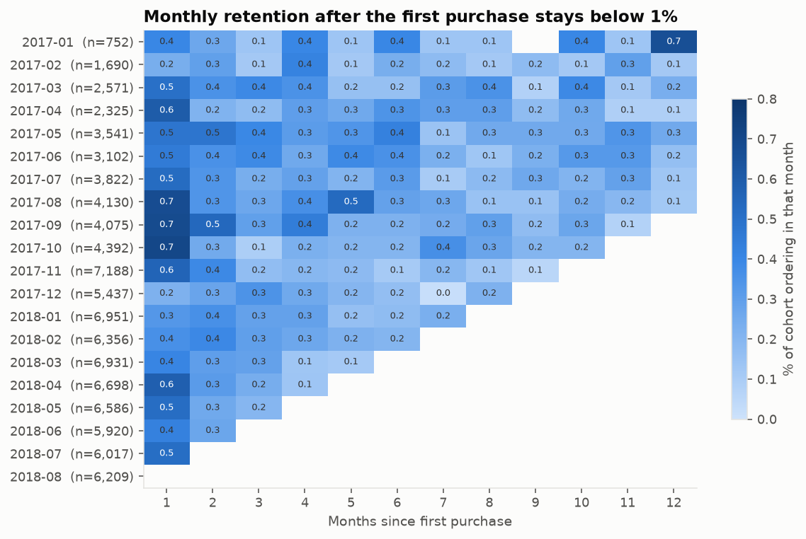
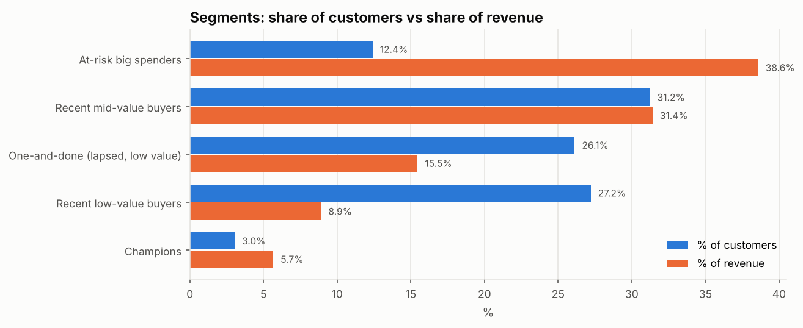
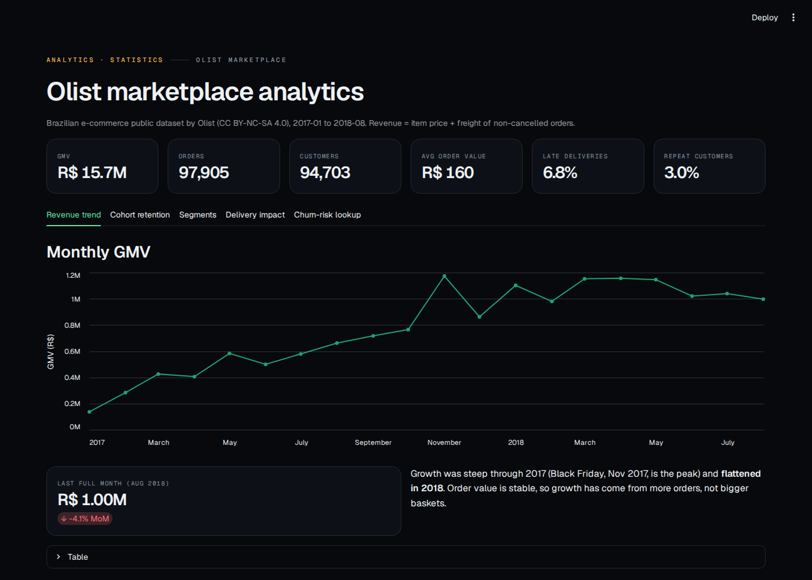
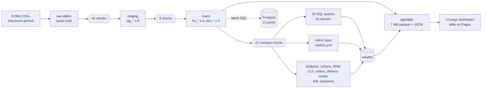
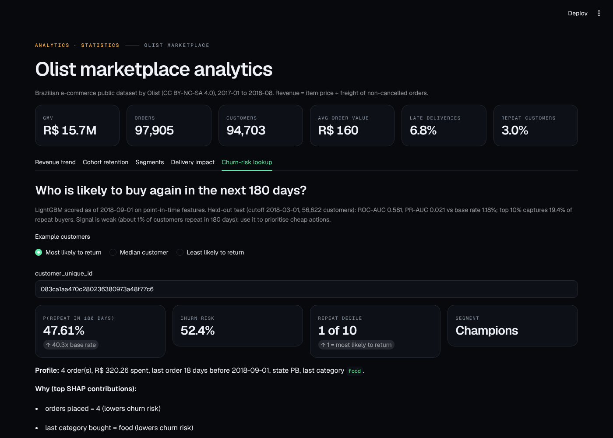

# Olist e-commerce analytics

[](https://github.com/srini2k03/olist-ecommerce-analytics/actions/workflows/ci.yml)
[](https://github.com/srini2k03/olist-ecommerce-analytics/actions/workflows/build-data.yml)
[](https://github.com/srini2k03/olist-ecommerce-analytics/actions/workflows/pages.yml)

An analytics product on the **real** Olist Brazilian e-commerce dataset (99,441 orders, 9 tables, Sept 2016 – Oct 2018): a layered DuckDB warehouse with data-quality and referential-integrity checks, 26 domain SQL queries that also run on Postgres, a documented metric layer that keeps revenue, freight, GMV, payment value and profit estimates apart, customer analytics (cohorts, RFM, CLV), uncertainty-aware seller ranking, a delivery-delay model validated on later months, a reusable statistics module, a simulated A/B test with a decision engine, business scenarios, and a 10-page filterable dashboard that runs in the browser.

- **Live dashboard:** https://srini2k03.github.io/olist-ecommerce-analytics/app/ (Streamlit compiled to WebAssembly with [stlite]; the first visit takes 10–30 s while Python starts in your browser).
- **Findings, executive summary and notebooks:** https://srini2k03.github.io/olist-ecommerce-analytics/ · [EXECUTIVE_SUMMARY.md](EXECUTIVE_SUMMARY.md)
- **Docs:** [architecture](docs/architecture.md) · [data dictionary](docs/data_dictionary.md) · [metrics](docs/metrics.md) · [SQL](docs/sql.md) · [statistics](docs/statistics.md) · [A/B testing](docs/ab_testing.md) · [data quality](docs/data_quality.md) · [limitations](docs/limitations.md)

[stlite]: https://github.com/whitphx/stlite

## Key findings

Every number comes from code in this repository run on the checksum-pinned data; sources are in the right column (`results/analytics/`, `results/sql/`, notebooks).

| # | Finding | Evidence |
|---|---|---|
| 1 | **Growth has stalled.** Jan–Aug 2018 GMV was +140% on the same months of 2017, but mean month-on-month growth from Feb to Aug 2018 was **−1.0%**; monthly GMV has stayed between R$ 0.98M and R$ 1.16M. | SQL 01, [findings.json](results/analytics/findings.json) |
| 2 | **Customers almost never return.** **3.0%** of 94,693 customers acquired in 2017–2018 ordered again; month-1 retention is **0.48%**; 30% of second orders are same-day split baskets; the first order is **97.8%** of all customer value. | SQL 10, 12, [cohorts](results/analytics/retention_curve.csv), [clv.json](results/analytics/clv.json) |
| 3 | **Late delivery goes with bad reviews.** Late orders average **2.27★** against **4.29★** on time (gap −2.02, 95% bootstrap CI −2.06 to −1.98; Cliff's δ = −0.64). The gap is negative and significant (Holm) in all 21 states and 29 categories large enough to test. An association: lateness was not randomised. | SQL 25, [late_vs_on_time.json](results/analytics/late_vs_on_time.json), [02_stats](notebooks/02_stats.ipynb) |
| 4 | **Lateness is regional and predictable at purchase.** The late rate is **21.4%** in Alagoas against **4.5%** in São Paulo; SP → RJ alone has **17.6% of all late deliveries**. A LightGBM model scored on later months (Apr–Jul 2018) reaches late-delivery PR-AUC **0.123** vs **0.069** for the lane's history (base rate 4.0%) and delivery-time MAE **5.20** days vs 5.65 (Olist's own promise: 14.56). | SQL 09, 13, [delivery_model.json](results/analytics/delivery_model.json) |
| 5 | **Value sits in lapsed one-time buyers.** "At-risk big spenders" (K-Means) are **12.4% of customers but 38.6% of revenue**; the transparent rule-based RFM segment of the same name is 14.7% / 27.5%. | [03_segmentation](notebooks/03_segmentation.ipynb), [rfm_segments.csv](results/analytics/rfm_segments.csv) |
| 6 | **Repeat behaviour is forecastable in aggregate, not per person.** BG/NBD + Gamma-Gamma predicted **739** repeat purchases for Mar–Aug 2018 against **720** actual (constant-rate baseline: 1,274), but ranks individual customers only modestly (ROC-AUC 0.59); the 180-day churn model's top decile captures 19.4% of repeat buyers (1.94x lift). | [clv.json](results/analytics/clv.json), [04_churn](notebooks/04_churn.ipynb) |
| 7 | **Simulated A/B test: free shipping from R$ 150 does not pay.** On real 2018 baskets with an assumed +15% multi-item lift, the subsidy costs **R$ 9.26 per treatment order** and contribution falls by about **R$ 58.5k a month** (95% CI −62.6k to −54.3k); the decision engine says **do not ship**, for any lift up to 50%. | [ab_test.json](results/analytics/ab_test.json) (**simulated**), [ab_testing.md](docs/ab_testing.md) |

<p align="center">
  
  
  
  
</p>

**Correction of an earlier claim.** A previous summary of this project quoted "an average review score of 4.29 vs 4.27 for late deliveries". The data say 4.29 for on-time and **2.27** for late deliveries (SQL 25, n = 89,443 and 6,381).

## Architecture



DuckDB is the warehouse (one file, no server). Postgres is kept only as a CI portability check: the same staging, marts and analytics SQL must give identical results on both engines with the real data. The pure pandas/numpy parts of the `olist` package (metric layer, cohorts, RFM, seller ranking, delivery breakdowns, experiment simulator, scenarios) are shared by the pipeline and the in-browser dashboard, so the dashboard computes exactly what the pipeline reports. Details, the ER diagram and design decisions: [docs/architecture.md](docs/architecture.md).

## Repository

```
sql/staging/, sql/marts/   8 staging and 7 mart models (documented headers); columns.yml documents every mart column
sql/analytics/<domain>/    26 queries: revenue, customer, order, delivery, payment, product, seller, review
metrics/metrics.yml        32 metric definitions (formula, SQL, unit, kind, caveats, assumptions)
src/olist/
  pipeline/                layered build (models.py), 75 data-quality checks (checks.py), CLI (run.py)
  metrics.py               metric layer in pandas (dashboard and results)
  analytics/               cohorts, rfm, sellers, delivery, clv (BG/NBD + Gamma-Gamma), delivery_model
  stats/                   core (no SciPy), inference (SciPy), effect sizes, A/B helpers
  experiments/             A/B simulator, decision engine, sensitivity
  scenarios.py             business scenarios with labelled inputs
  analysis.py              writes results/analytics/
  db.py, schema.py, warehouse.py, sql_runner.py, segmentation.py, model/   loaders, notebooks' helpers, churn model
app/                       streamlit_app.py + dashboard/ (10 pages); app/data = the prebuilt bundle
results/                   data_quality/, sql/, analytics/, metrics/, figures/, benchmarks/
notebooks/                 01_eda, 02_stats, 03_segmentation, 04_churn (executed, outputs committed)
scripts/                   fetch, build_warehouse, run_sql, run_analysis, build_app_data, build_docs, benchmark, smoke tests, build_site
docs/                      architecture, data dictionary, metrics, SQL, statistics, A/B, data quality, limitations
tests/                     300 tests: known-answer SQL, pipeline failures, metrics vs SQL, stats vs SciPy, analytics, dashboard
```

## Data and licence

- **Dataset:** [Brazilian E-Commerce Public Dataset by Olist](https://www.kaggle.com/datasets/olistbr/brazilian-ecommerce), **CC BY-NC-SA 4.0** (attribution, non-commercial, share-alike). The raw CSVs are **not committed**. `scripts/fetch_data.py` downloads them through the Kaggle API when `KAGGLE_USERNAME`/`KAGGLE_KEY` are set, otherwise from Olist's own repository [`olist/work-at-olist-data`](https://github.com/olist/work-at-olist-data) **pinned to commit `d9e4980`**, and checks every file against a SHA-256 checksum.
- **Derived artefacts** (aggregates, figures, the coded order/item bundle and per-customer scores in `app/data`) are shared under the same CC BY-NC-SA 4.0 terms.
- **Code:** MIT ([LICENSE](LICENSE)).

## Reproduce

```bash
python -m venv .venv && source .venv/bin/activate
make setup        # pip install -r requirements-dev.txt -e .
make warehouse    # fetch + verify the CSVs; raw -> checks -> staging -> marts; results/data_quality/
make sql          # run the 26 queries, snapshot results/sql/*.csv
make analysis     # metrics, cohorts, RFM, CLV, sellers, delivery model, A/B, scenarios -> results/analytics/
make notebooks    # execute the notebooks in place
make app-data     # rebuild app/data (bundle + churn model scores)
make test lint    # pytest + ruff
make app          # streamlit run app/streamlit_app.py
python scripts/build_docs.py          # regenerate docs/data_dictionary.md, metrics.md, sql.md
python scripts/benchmark.py           # results/benchmarks/benchmark.json
```

Configuration is optional; see [`.env.example`](.env.example) (`OLIST_DATA_DIR`, `OLIST_DUCKDB`, `OLIST_PG_DSN`, `OLIST_PG_TEST_DSN`, `KAGGLE_*`, `OLIST_LOG_LEVEL`). **Postgres:** set `OLIST_PG_DSN`, run `make postgres` to build the same layers there, then `make sql-compare` to require identical results.

## Data pipeline and quality

`python -m olist.pipeline` loads the CSVs with declared types (a missing column or text in a numeric column raises `SchemaError`; unparseable timestamps are counted), runs **45 raw checks** (keys, foreign keys, accepted values, ranges, date order, completeness), builds **8 staging models** (zip prefixes padded, geolocation reduced to one median point per prefix inside Brazil, categories translated, reviews deduplicated at (review_id, order_id), anomalies flagged), runs 9 staging checks, builds **7 marts** and runs **21 contract checks** (one row per order/item/person, item revenue, freight and payments reconcile with the raw tables to the cent, GMV identity, cohorts and sequences consistent). An error-severity failure stops the pipeline. Current report: **75 checks, 64 pass, 11 warn (known source issues handled in staging), 0 fail** ([report](results/data_quality/report.md), [what was found](docs/data_quality.md)). The biggest find: the CSVs dropped the leading zero of 23,995 customer and 1,027 seller zip prefixes, so 24,265 customers did not match the geolocation table; after padding, 280.

## Metric layer

[`metrics/metrics.yml`](metrics/metrics.yml) defines 32 metrics (revenue, orders, payments, customers, delivery, reviews, products, sellers) with label, unit, definition, caveats and the SQL over the marts; `src/olist/metrics.py` implements them in pandas for the dashboard, and a test requires both to agree. Full catalogue: [docs/metrics.md](docs/metrics.md).

| Quantity | Formula | Jan 2017 – Aug 2018 | Observed? |
|---|---|---:|---|
| Item revenue | SUM(price) of valid orders | R$ 13.45M | yes |
| Freight | SUM(freight_value) | R$ 2.24M | yes |
| GMV | item revenue + freight | R$ 15.69M | yes |
| Payment value | SUM(payment_value) (incl. instalment interest, vouchers) | R$ 15.69M | yes; differs from GMV on 312 orders |
| Marketplace revenue | assumed 10% take rate x item revenue | R$ 1.34M | **estimate** |
| Contribution | marketplace revenue − 2% payment cost | R$ 1.03M | **estimate** |

A *valid order* is one that was not cancelled or unavailable and has at least one item (`fct_orders.is_valid`); unifying this definition across queries changed, for example, the repeat-customer count from 2,875 / 94,707 to 2,873 / 94,693.

## SQL library (`sql/`)

The 26 analytics queries are organised by domain under `sql/analytics/<domain>/` and read only the marts (a test enforces it). Each file starts with a header giving its **business question**, **method**, **expected output** and **dialect notes**; the same text runs on DuckDB and Postgres, and CI compares the results cell by cell on the real data. Catalogue: [docs/sql.md](docs/sql.md).

| Domain | Queries |
|---|---|
| revenue | 01 monthly GMV with MoM/YoY growth and 3-month average · 18 item revenue vs freight vs GMV vs payments |
| customer | 02 cohort retention · 03 RFM (NTILE) segments · 10 repeat-purchase rate · 12 time to second order · 15 customer value deciles · 20 cohort revenue |
| order | 11 basket size · 16 purchase timing · 17 status funnel (cancellation, completion) |
| delivery | 09 state SLA · 13 late-delivery hot-spot lanes · 22 delivery by category · 23 promise accuracy by month |
| payment | 07 payment mix · 26 instalments and vouchers by order value |
| product | 06 category Pareto · 08 freight burden · 19 category growth (same months YoY) · 24 category scorecard |
| seller | 05 revenue league · 21 seller scorecard (input to the uncertainty-aware ranking) |
| review | 04 delay buckets vs review · 14 review text proxies · 25 review by delivery status |

The queries use CTEs, joins and window functions (`LAG`, `LEAD`, `NTILE`, `RANK`, `DENSE_RANK`, `PERCENT_RANK`, `ROW_NUMBER`, running `SUM() OVER`, `PERCENTILE_CONT ... WITHIN GROUP`). Portability rules: `DATE - DATE` for days, `CAST(date_trunc('month', ts) AS DATE)` for months, `EXTRACT` cast to `INTEGER`, no `ROUND(double, n)`, `LOWER(...) LIKE` instead of `ILIKE`, deterministic `ORDER BY` (float ties sort differently on the two engines), and anti-joins as `LEFT JOIN ... IS NULL` (Postgres runs `NOT EXISTS` inside `CASE` row by row; that made the CI parity job hang before it was fixed).

## Methods in brief

- **Statistics** ([docs/statistics.md](docs/statistics.md)). `olist.stats.core` (no SciPy, also used in the browser): descriptive CIs, Wilson intervals, two-proportion test with Cohen's h, bootstrap, permutation test, Bonferroni/Holm/Benjamini-Hochberg, power and sample size; `olist.stats.inference` adds Welch, Mann-Whitney, chi-square and a stratified mean difference with Holm-adjusted strata and a pooled estimate. Notebook 02 adds a proportional-odds regression (late: odds ratio 0.068 for a higher score).
- **Cohorts and RFM.** Cohort = month of the first valid order ever; the retention curve averages only cohorts observed long enough. RFM segments are explicit rules on NTILE recency/monetary scores and the order count (97% of customers ordered once), matching SQL 03; notebook 03's K-Means clustering is kept for comparison.
- **CLV.** Observed GMV kept separate from a BG/NBD + Gamma-Gamma forecast; validated on Mar–Aug 2018 against a constant-rate baseline; parameter-recovery tests on simulated data.
- **Seller ranking.** 30-order minimum, Wilson intervals, empirical-Bayes shrinkage of late, bad-review and cancellation rates, a composite score where service quality outweighs revenue, Monte Carlo rank intervals.
- **Delivery model.** Features known at purchase only (seller and lane history from earlier deliveries via `merge_asof`); train 2017 / validate Q1 2018 / test Apr–Jul 2018; choice made on validation, refit, single test evaluation; baselines: Olist's promise and the lane mean.
- **Simulated A/B test and decision engine** ([docs/ab_testing.md](docs/ab_testing.md)). Real 2018 baskets resampled into two arms, assumed effects, power-based plan, SRM check, z-test + Bayesian P(B>A), bootstrap CIs, subsidy cost and contribution, explicit ship / do-not-ship rules, sensitivity grid and tornado.
- **Scenarios.** Faster delivery, shipping subsidy, more repeat purchases, fewer cancellations, better sellers, conversion/AOV, every input labelled *observed* or *assumption*.

### Being candid about the churn model

Olist's repeat rate is about 3% overall and about 1.2% in a 180-day window, and the data has no browsing or marketing signals. No model here is strong: the 180-day churn model reaches ROC-AUC 0.58 and the CLV model ranks returners at ROC-AUC 0.59. Both are useful in aggregate (the CLV model predicted 739 vs 720 repeat purchases) and for ranking **cheap** retention actions; neither should justify expensive per-customer offers, and an uplift holdout test should come before any incentive spend.

## The dashboard

`app/streamlit_app.py` has 10 pages: **executive overview** (12 KPI cards with metric definitions as tooltips, monthly GMV and orders, key findings, data-quality status, money definitions), **revenue**, **customers** (new vs returning, value concentration, CLV observed vs predicted, the churn-risk lookup by `customer_unique_id` with SHAP reasons), **cohort retention**, **RFM segments**, **sellers** (uncertainty-aware ranking, funnel plot, drill-down), **delivery** (promise vs actual, Wilson intervals by state, lanes, distance and freight bands, model card), **products**, **A/B testing** and **business simulation**.

Sidebar filters (purchase months, customer state, category, seller state, seller) change every number: order filters select orders; item filters select items, so category and seller revenue is attributed exactly. Every page has CSV downloads and empty states; estimates, simulations and full-data panels are labelled. It reads only `app/data` (7.0 MB: every order and item as compact parquet plus JSON summaries) and computes with the same `olist` modules as the pipeline; a test checks that its metrics on the bundle equal the warehouse snapshot.

<p align="center"></p>

**Deploy.** GitHub Pages (live): `scripts/build_site.py` copies the app, the `olist` modules it imports and the bundle into `site/app/` with a [stlite] loader; the Pages workflow opens all 10 pages in headless Chromium before publishing. Streamlit Community Cloud (optional): root `requirements.txt` holds only the runtime dependencies; entry point `app/streamlit_app.py`; Python 3.12+.

## Benchmarks

`python scripts/benchmark.py` times every stage in a fresh process (so peak memory is per stage) and every query as a median of 10 runs after a warm-up. Numbers below: [`results/benchmarks/benchmark_local.json`](results/benchmarks/benchmark_local.json) (commit eeaf14d, dev sandbox, 4 vCPU), [`benchmark_local_e70f19e.json`](results/benchmarks/benchmark_local_e70f19e.json) (before the two optimisations below, with the Postgres slow paths) and [`dashboard_load.json`](results/benchmarks/dashboard_load.json). `benchmark.yml` reruns it on a GitHub runner.

| Stage | DuckDB | Postgres 16 |
|---|---:|---:|
| Load the 9 CSVs (1.55M rows) with types | 3.2 s (peak 546 MB) | 9.7 s |
| 45 raw checks | 0.9 s | 2.0 s |
| Build 8 staging + 7 mart models | 3.9 s (peak 572 MB) | 9.2 s |
| 30 staging + mart checks | 0.7 s | 1.4 s |
| 26 analytics queries, median / slowest | 18 ms / 85 ms | 128 ms / 343 ms |

| Optimisation (found by the CI parity job and this benchmark) | Before | After |
|---|---:|---:|
| Postgres foreign-key check: `NOT EXISTS` inside `CASE` -> `LEFT JOIN` anti-join | 202 s | 0.11 s |
| Postgres `fct_orders` on staging tables without vs with `ANALYZE` | 235 s | 2.4 s |
| Query 14 (review text): `LOWER()` once in a CTE instead of in 16 `LIKE`s | 454 ms (Postgres) | 307 ms; DuckDB unchanged (85 ms) |
| Metric layer `compute_all` on 99k orders (cache of shared subsets) | 203 ms | 56 ms |

Dashboard: the bundle is 6.97 MB and loads in 0.13 s; a rerun with the default filters costs 12 ms of filtering, 56 ms for all metrics, 27 ms for the cohort matrix, 64 ms for RFM and 72 ms for the seller ranking (server-side Python). Clicking through the pages takes 1.4–1.8 s each under `streamlit run` locally and 1.8–2.9 s each in the browser (stlite, Pages run 45380021360), both including a fixed 1.0–1.2 s settle wait in the test; the first in-browser render takes 14.4 s while Pyodide starts.

## Tests

`pytest` runs 300 tests (26 of them need `OLIST_PG_TEST_DSN` and run in CI against Postgres):

- **known answers** on a hand-made 6-order dataset (money columns, cohorts, repeat flags, delivery days, lateness, reviews, zip padding, distances) and for 7 queries;
- **pipeline failures**: orphan items, duplicate keys, out-of-range scores, missing columns and bad timestamps;
- **every query** on DuckDB and Postgres with identical results; analytics may only read marts;
- **metric layer**: pandas equals SQL for all 32 metrics; exact values on the hand-made data;
- **statistics** against SciPy/statsmodels; BG/NBD and Gamma-Gamma parameter recovery; seller shrinkage and Wilson bounds; leakage test for the delivery features; A/B decision rules;
- **dashboard**: every page renders (Streamlit AppTest), filters change the numbers, empty states, bundle metrics equal the warehouse snapshot, no heavy imports in the browser bundle;
- **docs**: generated docs are current and every mart column is documented.

CI also runs ruff, executes the notebooks, and drives `streamlit run` with Playwright through all 10 pages; the Pages workflow does the same in the browser (stlite).

## CI/CD

| Workflow | What it does |
|---|---|
| `ci.yml` | ruff + pytest; the layered build and all 26 queries on the real data in DuckDB and Postgres 16 with identical results and unchanged snapshots and data-quality report; notebooks executed; Playwright smoke test of all pages |
| `build-data.yml` | fetches the real data, rebuilds the warehouse, SQL snapshots, analytics results, notebooks, figures, screenshots and `app/data`, and commits changes |
| `pages.yml` | builds the site (findings, summary, notebooks, dashboard), opens all 10 dashboard pages in Chromium via stlite, then publishes to `gh-pages` |
| `benchmark.yml` | on demand: times the pipeline, queries (both engines) and dashboard computations on a GitHub runner and commits `results/benchmarks/benchmark_ci.json` |

## Honesty notes

- All results come from the real, checksum-verified dataset (Olist commit `d9e4980`); the `build-data` workflow recomputes them. Reruns on the same machine are byte-identical; a rebuild on a GitHub runner differs only in the 6th-7th significant digit of optimiser outputs (CLV, the notebooks' ordinal regression).
- **The A/B test is simulated.** Only its baskets and volumes are real; effects are assumptions, labelled as such in every output.
- **Estimates are labelled.** Marketplace revenue and contribution rest on an assumed take rate and payment cost; the dataset has no commission or cost data.
- Associations are not causal effects: the late-delivery link holds in every stratum and with controls, but a promise-date experiment is the proper confirmation. Scenarios that borrow an association say they treat it as causal (an upper bound).
- Customer-level predictions (churn, CLV) are weak by nature here; their value is in aggregate and in ranking cheap actions.
- Review "sentiment" uses Portuguese keyword proxies, not a trained classifier.
- Earlier versions of this README contained a wrong late-vs-on-time review figure (see the correction above).
