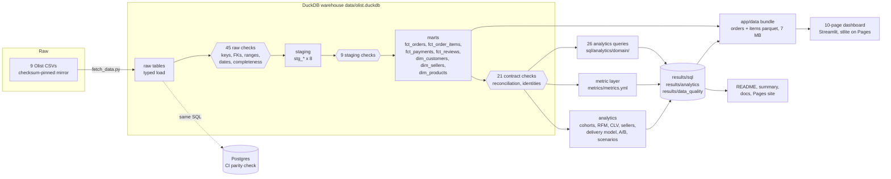
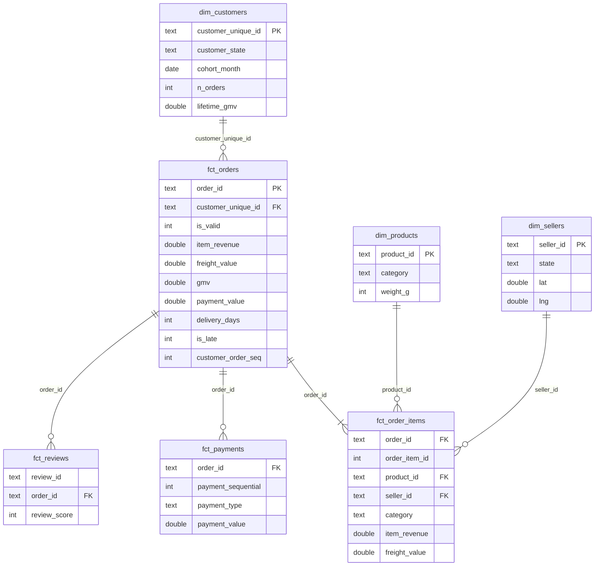

# Architecture

## Pipeline

`python -m olist.pipeline` builds the warehouse layers and stops on any failing
error-severity check. `scripts/run_sql.py`, `scripts/run_analysis.py` and
`scripts/build_app_data.py` produce the results and the dashboard bundle; the `build-data`
workflow reruns all of them on the real data and commits the outputs.

## Layers

| Layer | What it holds | Rules |
|---|---|---|
| raw | the 9 CSVs with declared types (`olist.schema`) | missing columns or text in numeric columns raise `SchemaError`; unparseable timestamps are counted |
| staging (`stg_*`) | one model per source table | normalise types, case, zip prefixes, categories; deduplicate; flag known timestamp anomalies; no business logic |
| marts (`fct_*`, `dim_*`) | star schema for analytics | the only place that defines a valid order, money columns, delivery outcomes and customer sequence |
| analytics | `sql/analytics/<domain>/` | read marts only (tested) |

Models are plain `SELECT` statements with a header (`Layer`, `Grain`, `Purpose`,
`Depends on`, `Transformations`). The builder sorts them topologically and materialises each
with `CREATE TABLE ... AS`, which DuckDB and Postgres share. On Postgres each model is
`ANALYZE`d after creation (without statistics the planner chose nested loops and `fct_orders`
took 257 s instead of 4 s; see the benchmark).

## Why DuckDB, and why Postgres stays

DuckDB is the engine: an embedded file, no server, fast enough that the whole layered build
takes about 7 s on a laptop-class machine. Postgres is kept only as a **CI portability
check**: the same staging, marts and analytics SQL run on both engines on the real data and
must give identical results. It costs one CI job and no runtime code, and it guarantees the
SQL can move to a server warehouse; it already caught two engine-specific performance traps
(correlated `NOT EXISTS` inside `CASE`, missing planner statistics) and one ordering
nondeterminism. There is no second production database to maintain.

## Entity-relationship diagram (marts)

Raw-layer relationships (enforced by the raw checks): `orders.customer_id → customers`,
`order_items.order_id → orders`, `order_items.product_id → products`,
`order_items.seller_id → sellers`, `order_payments.order_id → orders`,
`order_reviews.order_id → orders`, `products.product_category_name → category_translation`
(2 categories missing; translated in staging). Full column list:
[data_dictionary.md](data_dictionary.md).

## One implementation, two runtimes

The metric layer (`olist.metrics`), the browser-safe analytics (`olist.analytics.cohorts`,
`rfm`, `sellers`, `delivery`), the experiment simulator and the scenarios use only pandas and
numpy. The pipeline uses them to write `results/`; the dashboard imports the same modules,
from `src/` under `streamlit run` and from copies in the stlite bundle on GitHub Pages
(`scripts/build_site.py: APP_MODULES`). A test fails if the dashboard imports any other
`olist` module or anything heavy (SciPy, scikit-learn, LightGBM, DuckDB). Models that need
SciPy or LightGBM (CLV, the delivery model, the churn model) run in the pipeline, and the
dashboard shows their committed results, labelled "full data".

## Reproducibility

- Inputs: the 9 CSVs are fetched from a pinned commit of Olist's public repository and
  checked against SHA-256 checksums (`scripts/fetch_data.py`).
- Every generated JSON carries `run_metadata` (library versions, seed, a fingerprint of the
  raw files) but no timestamp, so a rebuild from the same code and data on the same machine
  is byte-identical (verified by running the analysis twice); on another CPU, optimiser
  outputs (the CLV fits) can differ in the 6th-7th significant digit. The git commit records
  when and from which code.
- Seeds: `olist.config.RANDOM_SEED`; LightGBM runs single-threaded and deterministic; inputs
  are loaded in a fixed order because resampling and bagging depend on row order.
