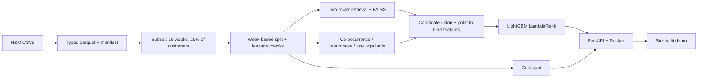

# Fashion recommender: design note

A production-style, two-stage recommender (candidate retrieval, then ranking) lives
in `src/recsys/` (imported as `recsys`). Everything below is built and tested on a
synthetic, H&M-shaped dataset. **Real-data results are pending**: they appear in
`results/recsys/` and in the README's generated section after the first
`recsys-train` run (see [Running on the real data](#running-on-the-real-data)).

## Why not Olist, and why H&M

Collaborative filtering learns from customers who interact with several items over
time. Olist has almost none of that signal, as the repo's own SQL snapshots show:

| Olist fact | Value | Source |
|---|---|---|
| Customers who ever place a second order | 2,875 of 94,707 (**3.04%**) | `results/sql/10_repeat_purchase_rate.csv` |
| ... within 90 days | 2.08% | same |
| Orders with a single item | 88,438 of 98,199 (**90.1%**) | `results/sql/11_basket_size.csv` |

With ~97% one-time buyers and one item per order, a user-item matrix is almost
empty, so any "recommender" would collapse to category popularity.

The [H&M Personalized Fashion Recommendations](https://www.kaggle.com/competitions/h-and-m-personalized-fashion-recommendations)
competition data has what Olist lacks: about 31.8M transactions from about 1.37M
customers over two years (Sep 2018 to Sep 2020), about 105K articles with rich
metadata (product code, type, colour, department, garment group), customer age and
frequent repeat buying. The competition's task (predict the 12 articles each customer
buys in the next 7 days, scored by MAP@12) is a natural offline benchmark. The rules do
not allow redistributing the data, so it is never committed: everything lives under the
gitignored `data/hm/`, and the API image mounts its artifacts instead of baking them in.

## Architecture



```
python -m recsys fetch        # Kaggle CLI -> data/hm/raw/*.csv + manifest.json -> data/hm/parquet/
python -m recsys subset       # last 16 weeks, 25% of customers -> data/hm/subset/
python -m recsys split        # train / validation / test -> data/hm/split/ + split_report.json
python -m recsys all          # baselines, retrieval, ranking, coldstart, report, export, benchmark
python -m recsys readme       # regenerate the README section from results/recsys/
python -m recsys --synthetic  # everything above on generated data, under data/hm/synthetic/
```

Each modelling stage is also a command (`baselines`, `retrieval`, `ranking`,
`coldstart`, `report`, `export`, `benchmark`) and a `make recsys-*` target. Data paths can
be overridden with `RECSYS_DATA_DIR`, `RECSYS_RAW_DIR` and `RECSYS_RESULTS_DIR` (or
`--data-dir`, `--results-dir`). A data folder created by `--synthetic` carries a
`SYNTHETIC` marker; any stage reading it writes results to `<data-dir>/results/`, never to
the committed `results/recsys/`, and every result file records `"data": "synthetic"` or
`"real"`. The README generator ignores anything that is not real.

## Data

**Fetch** (`recsys/data/fetch_hm.py`) downloads only `transactions_train.csv`,
`articles.csv` and `customers.csv` (not the ~30 GB of images) with the Kaggle CLI, from an
account that has accepted the rules (`KAGGLE_USERNAME`/`KAGGLE_KEY` or
`~/.kaggle/kaggle.json`; a clear error otherwise). A manifest records each file's size
and SHA-256. Conversion streams the 3.5 GB transactions file in 2M-row chunks with
explicit dtypes: `customer_id` (64 hex characters) becomes an int64 (its last 16 hex
digits; collisions are checked, and `customer_id_map.parquet` keeps the original ids),
`article_id` int32, `t_dat` day-resolution datetime, `price` float32,
`sales_channel_id` int8.

**Subset** (`recsys/data/subset.py`): the last 16 weeks and a 25% sample of the customers
active in them (both configurable), keeping all their transactions and customer rows.
The sample is a seeded hash of the customer id. The articles table is kept whole: it is
the catalogue, and filtering it by the kept transactions would leak which articles sell
in the validation and test weeks into the cold-start candidate pool. Exact counts are
written to `data/hm/subset/manifest.json`.

## Split, folds and leakage

Weeks are counted back from the last transaction date: **test** = the final week,
**validation** = the week before, **train** = everything earlier (configurable). Three
point-in-time folds (`recsys/data/folds.py`) each pair a target week with all history
strictly before it:

| Fold | Target week | History | Used for |
|---|---|---|---|
| `ranker_train` | last train week | train before it | ranker labels |
| `validation` | validation week | train | early stopping, tuning, model choices |
| `test` | test week | train + validation | the final report, once |

Every model producing candidates or features for a fold is fit on that fold's history
only. Checks run on every split and fold (no training row on or after the cutoff; target
rows inside their window; history strictly before the target), a `FeatureStore` refuses
history on or after its as-of date, and a test rewrites the ranker-training target week
and asserts that candidates and features are unchanged (only labels move).
`cold_start_report` counts target users and articles unseen in the history.

## Baselines

`fit(train_df)` / `recommend(user_ids, k)`, deterministic tie-breaking:

| Baseline | Idea |
|---|---|
| `popularity_1w` | Most purchased articles in the last week (filled from all-time popularity). |
| `age_popularity_4w` | Popularity in the user's age bucket over 4 weeks; unknown age falls back to global. |
| `item_cooccurrence` | Articles bought by the same customer within 7 days; neighbours of the user's 10 most recent articles (recency-weighted). |
| `repurchase` | The user's own articles from the last 8 weeks by recency, then frequency. |

## Two-tower retrieval (`recsys/retrieval/`)

* **User tower:** user-id embedding, age-bucket embedding and the mean of the item-id
  embeddings of the user's last 20 purchases, then an MLP and L2 normalisation.
* **Item tower:** article-id embedding plus embeddings of product type, product group,
  colour group, department, garment group and index group, then an MLP and L2
  normalisation.
* **Training:** examples pair each of the last 8 training weeks' purchases with the user
  state *before* that week. Sampled softmax over in-batch negatives with a temperature
  (0.05) and a **logQ correction** (subtract the log sampling probability of each item,
  so popular items are not over-penalised as negatives); duplicate positives in a batch
  are masked. AdamW, seeded, CPU. Early stopping on validation recall@100. Item- and
  user-id dropout (10%) train the out-of-vocabulary paths used for cold start.
* **FAISS:** exact `IndexFlatIP` for evaluation, `IndexHNSWFlat` (M 32, efSearch 128) for
  serving; the stage reports HNSW overlap with exact search, the candidate-recall loss and
  single-query latency of both. Candidate recall@100/200 and MAP@12 of raw retrieval are
  compared with the baselines, with bootstrap CIs.

## Ranking (`recsys/ranking/`)

* **Candidates:** union of two-tower top-100, co-occurrence top-30, the user's 30 most
  recent articles and age-bucket popularity top-30; each candidate records its sources.
  The report gives candidate recall per fold and the share of positives each source finds.
* **Features** (all from the fold's history):

  | Group | Features |
  |---|---|
  | user | age, recency, frequency, mean price, channel-2 share, active weeks, distinct articles |
  | item | purchases last 1 / 4 weeks, trend, mean price, days since first sale, product type/group, colour, department, garment and index group |
  | two_tower | two-tower score and rank |
  | cooccurrence | co-occurrence score |
  | history | times bought, days since last bought (article and product code), user affinity to the product type / garment group / index group, price vs the user's mean |
  | sources | source flags, number of sources, age-popularity rank |

* **Model:** LightGBM `lambdarank` grouped by user, binary label gain, trained on the
  ranker-training fold (users without a positive candidate dropped), lightly tuned on
  validation (8 configurations, early stopping on validation NDCG@12, selection by
  validation MAP@12), evaluated on test once.
* **Ablation:** drop each feature group, retrain with the chosen parameters and number of
  rounds, and report the validation MAP@12 difference with a paired bootstrap CI; plus
  LightGBM gain importances.

## Cold start (`recsys/coldstart/`)

* **New users** (no purchase before the target week): a blend of age-bucket popularity and
  last-week trending (purchases x growth). The blend weight is chosen on validation cold
  users, and validation also decides whether cold users are served by the blend or by the
  ranker (whose candidates include age popularity and whose user tower has an OOV path).
* **New articles** (first sold in the target week, unseen by the id embedding): the item
  tower's attribute-only path (id dropout during training) embeds every unseen catalogue
  article, so they can be indexed and retrieved. Compared with a seen-only index and with
  a model trained without id dropout: new-article recall@K, the share of new articles
  shown and overall recall.
* Results are reported separately for cold users, warm users and the new-article slice.

## Evaluation report and A/B simulation

`recsys/evaluate/report.py` compares every stage on the test week (baselines, two-tower
retrieval, two-tower + ranker, ranker + cold start) on Recall@12/50, NDCG@12, MAP@12
(competition definition), HitRate@12, coverage, mean popularity percentile and the Gini of
recommendation counts, with 95% bootstrap CIs over users and **paired** bootstrap
differences vs the best baseline (chosen on validation). Output: `report.md` + `report.json`.

`recsys/abtest.py` reuses `olist.stats.abtest`. Conversion = the user buys one of the 12
recommended articles in the week (offline: HitRate@12). The power analysis is sized for
the offline relative lift times an explicit **offline-to-online shrinkage** (0.5). The
simulated experiment resamples test users, assigns them at random and replays their
outcomes (a treatment user converts as under the new system with probability equal to the
shrinkage, otherwise as under control). It then runs an SRM chi-square check, the
two-proportion lift test with CI and a Beta-Binomial check, and states launch / no launch
with the reasoning, including a caveat when the offline paired difference is itself not
significant (the simulation treats the offline sample as the population).

## Serving

* `python -m recsys export` writes `artifacts/serving/`: the test-fold state (user vectors
  for every customer with history, the HNSW index, the candidate generator, the feature
  store, the LambdaRank model, the cold-start model, the catalogue, recent histories).
* `recsys/serve/api.py` (FastAPI): `GET /recommend/{customer_id}?k=12[&age=]` returns
  articles with scores, sources and attributes; known customers go through HNSW ->
  candidates -> features -> ranker, customers with history but no stored vector get one
  from the user tower, and customers with no history (or unknown ids) take the cold-start
  path chosen on validation. Also `GET /health`, `GET /items/{article_id}`,
  `GET /users/sample` and `GET /users/{customer_id}/history`. Ids are returned as strings
  (int64 exceeds JavaScript's safe integers); raw 64-character hex ids are accepted.
* `python -m recsys.serve.benchmark` reports p50/p95/p99 latency in process or over HTTP
  (`--url`), mixing known and unknown customers; the pipeline's `benchmark` stage writes
  `serving_latency.json`.
* `docker/recsys.Dockerfile`: Python 3.13 slim, CPU-only PyTorch, non-root user,
  healthcheck on `/health`, bundle mounted at `/artifacts`.
* `app_recsys/streamlit_app.py`: pick a customer or "new user" (with an age), see the
  purchase history and the recommendations with sources and attributes. It only calls the
  API; the Olist stlite dashboard in `app/` is untouched and gains no ML dependencies.

## CI

* `recsys-ci.yml` (changes under `src/recsys`, `tests/recsys`, `app_recsys`, `docker` or
  the recommender requirements): ruff, `pytest tests/recsys` with CPU-only PyTorch from the
  PyTorch index, a README freshness check, the synthetic end-to-end pipeline, then a Docker
  build and API smoke test on the synthetic bundle.
* The main `ci.yml` also runs `tests/recsys`; tests that need PyTorch or FAISS skip there.
* `build-data.yml` ignores pushes that touch only recommender files, so recommender work
  never triggers the real-data Olist rebuild.
* `recsys-train.yml` runs the real-data pipeline (below).

## Running on the real data

1. Accept the competition rules on Kaggle, then add the repository secrets
   `KAGGLE_USERNAME` and `KAGGLE_KEY`.
2. Copy `.github/recsys-request.example.json` to `.github/recsys-request.json` (adjust
   `subset_weeks` / `customer_frac` if needed) and push it to `main`, or start
   *Recsys train* by hand from the Actions tab.
3. The workflow fetches the data, runs every stage on a standard runner (4 vCPU, 16 GB,
   expected 1.5 to 3 hours for 16 weeks x 25% of customers), commits `results/recsys/` and
   regenerates the README section. Without the secrets it skips with a notice.

Locally: `make recsys-setup recsys-data recsys-all`, then `make recsys-serve` and
`make recsys-demo`.

## Limitations

Offline metrics on a single test week; a sample of the last 16 weeks rather than the full
two years; HitRate@12 as the conversion proxy and an assumed shrinkage in the A/B
simulation; no image or text features; the serving bundle is a static snapshot as of the
test week (no streaming feature updates).
